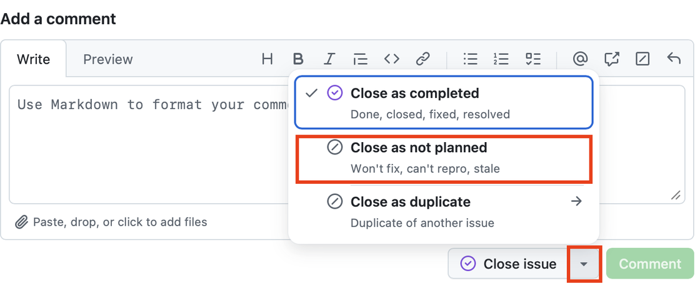

# check-pending-release

This GitHub action reports commits that are not part of any release yet: it
compares the current commit against the most recent tag, ignoring changes to
paths that do not warrant a release such as CI configuration, and tracks what
it finds in a GitHub issue.

Changes are reported only once they have been left untouched for
`min-quiet-days`, so that a rework spanning several weeks is not flagged while
it is still going on; what gets reported is work someone walked away from.
Changes to ignored paths do not reset that clock. While such changes exist, the
action keeps a single open issue up to date; once a release has been made, it
comments on that issue and closes it. If you close the issue yourself, no new
one is opened right away; see
[Closing the issue yourself](#closing-the-issue-yourself).

## Usage

The check needs the full history and all tags, so check out with
`fetch-depth: 0`, and it needs permission to write issues. Add the following as
`.github/workflows/check-pending-release.yml` to your package repository:

```yaml
name: Check for pending release

on:
  schedule:
    - cron: '0 6 * * 1'   # every Monday at 06:00 UTC
  release:
    types: [published]    # close the issue once a release is made
  workflow_dispatch:

permissions:
  contents: read
  issues: write

jobs:
  check:
    runs-on: ubuntu-latest
    steps:
      - uses: actions/checkout@v7
        with:
          fetch-depth: 0
      - uses: gap-actions/check-pending-release@v1
```

### Closing the issue on release

The `release` trigger above only fires for releases made by hand, because GitHub
starts no workflow run from an event created with the default `GITHUB_TOKEN` -
which is what [release-pkg](https://github.com/gap-actions/release-pkg) uses. To
close the issue right away for those too, run the check as another job of the
release workflow:

```yaml
  close-pending-release-issue:
    needs: release
    runs-on: ubuntu-latest
    permissions:
      contents: read
      issues: write
    steps:
      - uses: actions/checkout@v7
        with:
          fetch-depth: 0
      - uses: gap-actions/check-pending-release@v1
```

Otherwise the next scheduled run closes it.

### Closing the issue yourself

You can also close the issue yourself. What happens next depends on how you
close it:

- Closed as *completed*, the default: no new issue is opened until further
  changes are committed; those are then reported in a new issue.
- Closed as *not planned*: no new issue is opened until the next release, even
  if further changes are committed. Use this when you know a release will not
  happen soon.

To close an issue as not planned, click the arrow next to the "Close issue"
button below the comment box, and choose "Close as not planned":



### Configuration examples

The [inputs](#inputs) go in a `with:` block under the step that uses the action.

Ignore changes to more paths. Giving `ignore` replaces the default list, so
repeat `.github` and `.gitignore`:

```yaml
      - uses: gap-actions/check-pending-release@v1
        with:
          ignore: |
            .github
            .gitignore
            tst
```

Report changes only once they have been left untouched for 60 days:

```yaml
      - uses: gap-actions/check-pending-release@v1
        with:
          min-quiet-days: 60
```

Check once a month instead of every week, by changing the `schedule` trigger:

```yaml
on:
  schedule:
    - cron: '0 6 1 * *'   # on the first of each month at 06:00 UTC
```

Check only on demand, by removing the `schedule` trigger. Start the check from
the Actions tab of the repository:

```yaml
on:
  release:
    types: [published]
  workflow_dispatch:
```

Turn the check off by deleting `.github/workflows/check-pending-release.yml`,
and the job running the action in the release workflow, if there is one.

### Inputs

All of the following inputs are optional.

- `ignore`:
  - Newline- or comma-separated list of path prefixes whose changes do not warrant a release. A prefix also covers everything below it, so `.github` ignores `.github/workflows/CI.yml`.
  - default: `".github\n.gitignore"`
- `min-quiet-days`:
  - Only report a pending release once its most recent change is this many days old.
  - default: `'7'`
- `open-issue`:
  - Set to `'false'` to only compute the outputs, without touching any issue.
  - default: `'true'`
- `issue-title`:
  - Title of the tracking issue.
  - default: `'Pending release'`
- `issue-label`:
  - Label used to find the tracking issue again; created if missing.
  - default: `'pending release'`
- `max-files`:
  - Maximum number of changed files to list in the issue.
  - default: `'50'`

### Outputs

- `pending`: `'true'` if there are unreleased changes, `'false'` otherwise.
- `since-tag`: the most recent tag the check compared against, empty if the repository has no tags.
- `files`: newline-separated list of files changed since that tag, ignored paths removed.
- `commits`: number of commits since that tag which changed non-ignored files, `0` if there is no pending release.
- `age-days`: age of that tag in days, `0` if the repository has no tags.
- `quiet-days`: days since the most recent unreleased change, `0` if there is no pending release.
- `tag-time`: time of that tag in seconds since the epoch, empty if the repository has no tags.
- `last-change-time`: time of the most recent unreleased change in seconds since the epoch, empty if there is no pending release.

A repository without any tags counts as pending, because nothing in it was ever
released.

Set `open-issue` to `'false'` to react to the outputs yourself:

```yaml
      - id: check
        uses: gap-actions/check-pending-release@v1
        with:
          open-issue: 'false'
      - if: ${{ steps.check.outputs.pending == 'true' }}
        run: echo "${{ steps.check.outputs.commits }} commits since ${{ steps.check.outputs.since-tag }}"
```

## Reusable workflow

The same check is also available as a reusable workflow, which wraps the
checkout, the permissions and the action itself. A package using it has no
boilerplate to maintain, and changes made here reach it without a commit in its
repository:

```yaml
name: Check for pending release

on:
  schedule:
    - cron: '0 6 * * 1'   # every Monday at 06:00 UTC
  release:
    types: [published]
  workflow_dispatch:

permissions:
  contents: read
  issues: write

jobs:
  check:
    uses: gap-actions/check-pending-release/.github/workflows/reusable.yml@v1
```

It accepts the same inputs as the action, except `open-issue`: a workflow that
reports nothing would have nothing left to do.

## Contact
Please submit bug reports, suggestions for improvements and patches via
the [issue tracker](https://github.com/gap-actions/check-pending-release/issues).

## License
The action `check-pending-release` is free software; you can redistribute
and/or modify it under the terms of the GNU General Public License as published
by the Free Software Foundation; either version 2 of the License, or (at your
option) any later version. For details, see the file `LICENSE` distributed
with this action or the FSF's own site.
